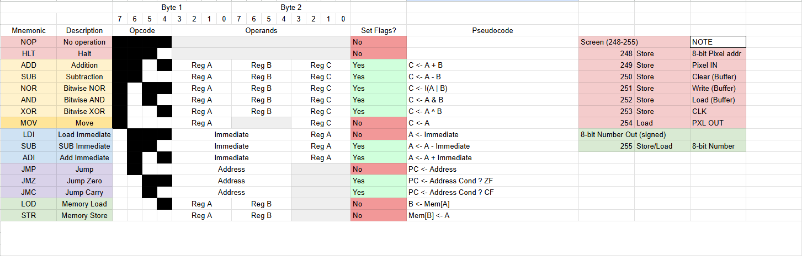
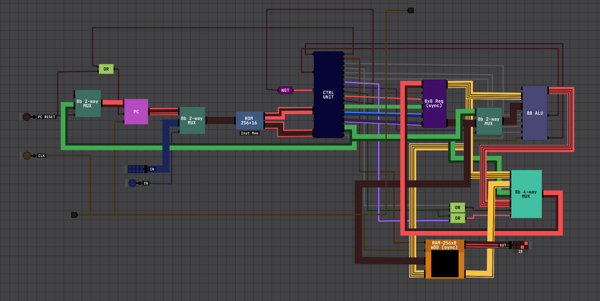

# Digital Logic Sim CPU8b-v1

An 8-Bit CPU with a custom ISA made in Sebastian Lague's [Digital Logic Sim](https://sebastian.itch.io/digital-logic-sim)
## Instruction Set & I/O Protocol


## CPU8b-v1



## Specs

**Registers**: 7 8-bit registers (r1-r7); r0 is a zero register

**Data memory**: 256 bytes of RAM, addresses 248-255 are memory mapped to I/O

**Instruction memory**: 256x16 ROM, 8-bit address, 16-bit output (high 8 & low 8)

**ALU** w/ add, subtract, & bitwise operations. 2 ALU flags: Zero & Carry

**Screen**: "dot" matrix screen, black and white, 8-bit address

**Number Display**: RAM address 255 is mapped to a signed number display

### Example

Sample machine code for plotting 2 points on dot matrix (0x10 & 0x20)

```machinecode
1000111110000001 ; LDI r1 248 ; 248 is screen address 
1000111110010010 ; LDI r2 249 ; 249 is pixel in (1 or 0)
1000111110110011 ; LDI r3 251 ; 251 is write to buffer
1000111111000100 ; LDI r4 252 ; 252 is load buffer to screen
1000000000010101 ; LDI r5 1
1000000100000110 ; LDI r6 16  ; 16 is the first address
1111011000010000 ; STR r6 r1  ; storing 16 into mem[248]
1111010100100000 ; STR r5 r2  ; storing 1 into mem[249]
1111010100110000 ; STR r5 r3  ; writing to buffer mem[251] (first operand (r5) is irrelevant)
1000001000000110 ; LDI r6 32  ; 32 is the second address
1111011000010000 ; STR r6 r1  ; storing 32 into mem[248]
1111010100100000 ; STR r5 r2  ; storing 1 into mem[249]
1111010100110000 ; STR r5 r3  ; writing to buffer mem[251] (irrelevant operand)
1111010101000000 ; STR r5 r4  ; loading buffer onto screen (irrelevant operand)
0001000000000000 ; HLT
```

*All components used to make the CPU are in the source*
